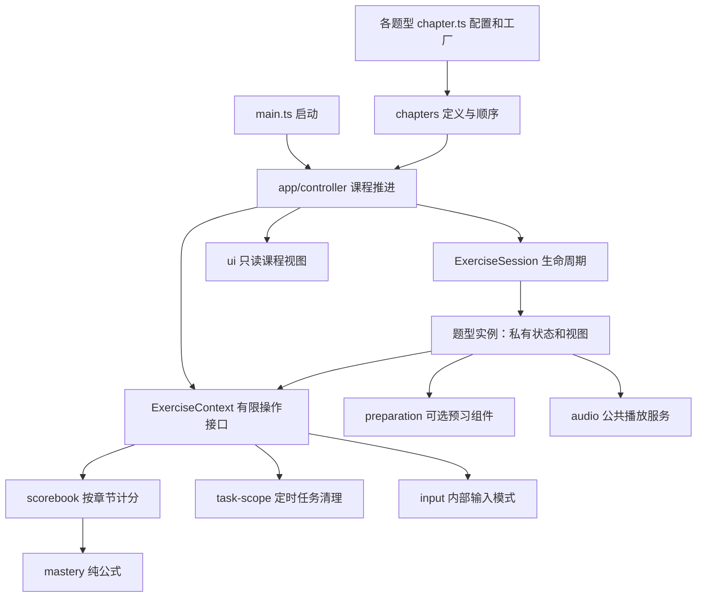

# 架构与功能边界

这个工程继续使用 Vite + 严格 TypeScript + 原生 DOM 组件。维护难度主要由职责和依赖决定：本次将共享状态、具体题型分支、隐式导航单例移出了公共流程，保留原来的 DOM、CSS、音频和交互规则。没有增加运行时框架或事件总线。

## 最小阅读入口

日常修改先看 [维护地图](maintenance.md)，选择对应的 1–3 个入口。添加现有题型章节通常只改一个定义文件和顺序表；新增题型先看 `exercises/contracts.ts`，无需读懂其他题型内部。

上图是运行关系；公共控制器的源码不导入任一具体题型。每个章节定义的 `create(context)` 已绑定自己的实现。`kind` 只用于标识和工具展示，不是必须修改的中央分支或枚举。

## 谁拥有什么

| 模块                               | 自己拥有                             | 不能越过的边界                                 |
| ---------------------------------- | ------------------------------------ | ---------------------------------------------- |
| `chapters/definitions`、`order.ts` | 章节配置、稳定 ID、启用顺序          | 不保存答题状态                                 |
| `features/*/chapter.ts`            | 本题型的参数、默认值、校验和实例工厂 | 不依赖章节下标                                 |
| `app/controller.ts`                | 当前章、轮次、错误数、难度和生命周期 | 不读答案、题袋、输入位置或预习轮数             |
| `features/listening`               | 题型袋、当前配对、选择、锁定         | 不接触填空或打字状态                           |
| `features/cloze`                   | 题袋、当前答案、输入、提示和重试     | 本地重试保留本题的提示失去奖励状态             |
| `features/typing`                  | 内容列表、按键步骤、DOM 引用、倒计时 | 通过公共接口申请重开或完成，不直接改课程       |
| `features/preparation`             | 本次预习的已听字母、位置、完成轮数   | 只收参数，不查询当前章节或决定正式题型         |
| `domain/scorebook.ts`              | 按稳定 ID 保存的分数，当前题奖励资格 | 外部只能调用计分操作，快照不暴露原记录         |
| `domain/mastery.ts`                | 纯公式                               | 不读 DOM、全局会话或当前章节                   |
| `input/mode.ts`                    | 网站内部 Caps、Shift、IME            | 不读实际输入字符、物理 CapsLock 或系统 IME     |
| `core/task-scope.ts`               | 定时器和动画帧的取消集合             | 换轮取消、离章销毁，已销毁作用域不能继续排任务 |
| `ui`                               | 公共页面、顶部统计、章节条、调试视图 | 通过只读视图模型显示，动作通过回调传入         |
| `audio`、`content`                 | 音频播放、拼音与词库服务             | 不决定课程和得分                               |

不再存在 `app/state.ts`、`app/navigation.ts`、`app/mastery.ts` 和 `features/registry.ts`。状态在工厂调用时创建，而非模块导入时共享。DOM 只在 `createUI()` 中挂载，所以命令行可以直接读取和校验章节目录。

## 生命周期和操作契约

1. `catalog.ts` 从定义文件读取章节，按 `order.ts` 排序并校验 ID、通关策略和配置。每个题型负责自己的参数校验。
2. 进入章节：销毁旧任务作用域和旧实例，创建新作用域、新实例；按 ID 取回会话内分数。
3. 进入一轮：取消上一轮定时任务和发音，重置内部输入模式与公共显示，恢复新题奖励资格，调用 `session.startRound()`。
4. 题型决定是否显示预习。`isPreparing()` 告诉课程当前不应执行正式通关检查；课程不需要知道是听音还是顺序预习。
5. 正确完成调用 `completeRound(ms)`；普通打字用第二参数 `true` 保持原先立即增加轮次、延迟转场的时机。错误先扣对应部分并 `recordError()`；整章重来用 `restartChapterRounds()`。
6. 课程按 `progress.type` 统一判断规定轮数或原始最终熟练度 100%。全部章节结束后提升难度并回到开头。每次进入章节至少渲染一次入口状态；没有预习的已达标新章节仍可复习，避免仅含此类章节的课程不停自动跳转。

`restartRound()` 表示开始一个新题生命周期，会恢复奖励资格；**同一填空题的错误重试不能调用它**，而应通过自己的 `tasks.after()` 清空输入，因此提示后反复重试依旧不计奖励。这个规则只需要在填空的 `answer.ts` 中理解。

所有延迟转场、错误高亮、预习自动下一轮、倒计时帧都走 `context.tasks`。离章后旧任务不能修改新题。使用原始 Promise 做额外异步工作时，开发者仍需在题型的 `dispose()` 中取消或忽略过期结果；这里没有隐式托管所有异步 API。

## 可配置范围与刻意保留的边界

听音可配置目标字母、候选音频范围、易混组合、题型比例、选项数量和反馈时长；填空可配置字母序列、空缺长度、上下文、预习轮数和时长；普通打字可配置题库、编译方式、题量、双行模式和计时参数。各章可覆盖计分标准、下限倍数、超额系数、奖励和惩罚。

现有听音和填空组件仍使用 A–Z 大写单字母与已有录音。支持参数组合，不承诺一个配置就能变成任意单词、音素或拖拽题；这种扩展应新增题型。布局骨架和音频上下文仍是单页面公共服务，适合当前一页一个活动练习的产品。

增加全新交互类型不需要修改控制器、键盘路由或全局状态；增加全新通关算法或全新公共页面布局则需要明确扩展公共契约。类型边界不能替代所有回归测试。

依赖限制由 `tests/unit/architecture.test.ts` 检查；扩展、多个实例、参数覆盖与离章取消由 `extensions.test.ts`、`task-scope.test.ts` 检查。示例在 `examples/`，未加入正式 35 章。

## 全部现有功能

章节清单见 `chapter-inventory.json`，运行 `npm run chapters` 可读取当前代码生成清单。

| 章节  | 功能                                                                       |
| ----- | -------------------------------------------------------------------------- |
| 1     | A–Z 发音预习；多项配对、单字辨音、易混对照；普通试听、提示试听；熟练度计分 |
| 2     | 三轮 A–Z 自动练习与额外重试；ABC 到 XYZ 的 24 个连续三元组；内联半透明提示 |
| 3–7   | 大小写字母、带键位提示的字母和字母串                                       |
| 8–11  | 数字、空格、换行及双行撰写                                                 |
| 12–19 | Caps 切换、Shift 组合、全角中文标点、英文标点及双行模式                    |
| 20–21 | 数字、标点、大小写、空格、换行混合段落                                     |
| 22–25 | 中文句子和段落的全拼，逐字确认、双行模式                                   |
| 26–27 | 中英混输，按词段切换内部输入法                                             |
| 28–33 | 中文缩写、全拼/缩写混合、段落缩写及各自双行模式                            |
| 34–35 | 中文、英文、数字、换行的综合练习                                           |

共同功能包括：四级时间倍率、倒计时颜色、错误/超时重启本章、成功和错误音效、顶部章节条、输入法与大小写居中指示、调试跳章/切难度/任务序列、UTF-8 和 GBK 词库导入、长文与双窗口自动滚动。

## 不可混淆的规则

**计分**：标准线为 2，单项最低 −6、无上限，超额按 0.25 折算。熟练度归一化与“达标覆盖率 × 均方缺口折扣”的博学度取平均。初始原始值 0.375 映射为显示 0%；左右分别映射欠分和进展。只有原始完成值为 1 才通关，不使用四舍五入后的文案判定。公式集中在 `domain/mastery.ts`。

**提示**：右侧字母提示试听或填空查看答案都会对当前章节每个计分项取 min(当前值, 0)，正分清零、负分保留，当前题也不能再奖励。左侧题目音频可以反复听。错题始终扣被考查的同一个部分，直到下限。

**预习与填空**：预习每个按键反馈，输错清空当前轮但保留已完成轮数；每轮 Z 成功后播放完整音效，前两轮自动重置，第三轮后出现手动重试。正式填空输入完整三个字母才判定，之前可以退格。

**输入**：只用 `KeyboardEvent.code` 判断按键身份。内部 Caps/Shift/IME 状态由章节和已接受任务改变。物理大小写、系统输入法、实际输入字符不控制页面模式。中文字音中的 ü 显示仍为 ü，实际任务键为 v。

**音频**：原始 26 个 MP3 字节独立存放，由 Vite 输出带内容指纹的 URL。开场预加载并解码，点击使用已解码缓冲区；保持旧版近静音检测和 12ms 起音余量；快速连点和换题取消过期播放。

## 后续功能的落点

如果以后需要持久化，在 `domain/scorebook.ts` 边界增加存储适配，用稳定 ID 存取分数；不把数组下标写入存储。账号、同步和路由等能力应在有相应产品需求时添加。当前成绩和导入词库仍仅保留于会话中。
